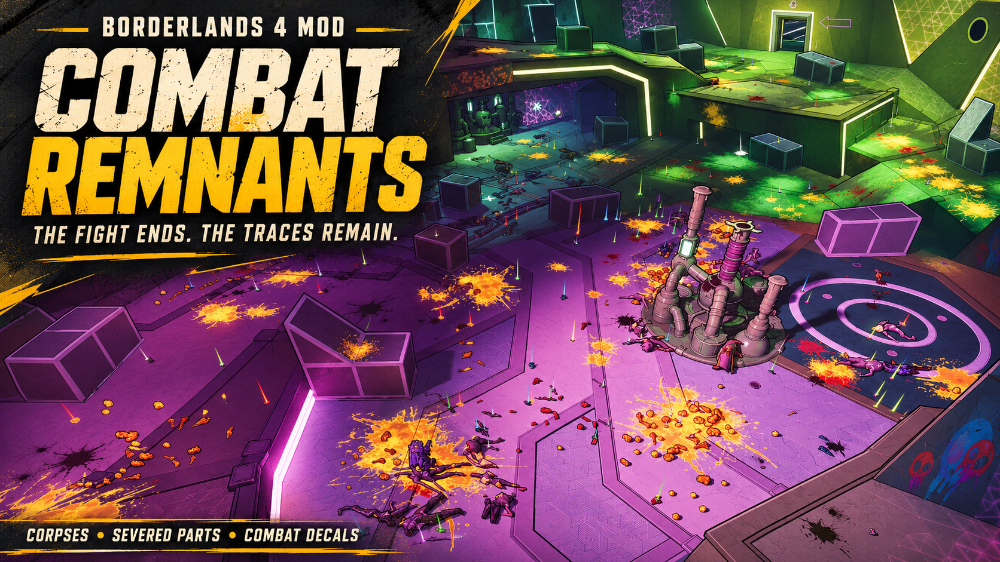

# Combat Remnants — Borderlands 4

**The fight ends. The traces remain. / 전투가 끝나도, 흔적은 남는다.**

**v0.18.2 — Alpha**

Preserve eligible enemy corpses and their linked severed parts, plus confirmed bullet, blood and blast decals. Each decal category has its own lifetime and FIFO count limit. Korean and English menus follow the game language, with a manual override.

[Downloads](https://github.com/popcorn-kim93/BL4Mods-CombatRemnants/releases) · [English installation](INSTALL.md) · [한국어 설치·사용 안내](INSTALL.ko.md) · [Changelog](CHANGELOG.md)

Choose **CombatRemnants-0.18.2.zip** from the v0.18.2 release. GitHub's Source code archives contain public documentation, not the installable mod.

## Features and defaults

- Starts automatically when enabled and the player is ready.
- Keeps eligible corpses and owner-linked severed parts as one group. Default corpse limit: 50. Oldest groups are released at the limit; parts have no separate cap.
- Boss retention defaults to on and is evaluated before elemental-death policy. Elemental deaths can stay indefinitely, fade slowly (default: 30 seconds), or use game cleanup.
- Retains original pooled decals without creating copies or hiding the originals. At a category's cap, its oldest mark is reused for the new mark; other categories keep their own budgets.
- Protected marks do not suppress new marks through the supported overlap gate. Unmanaged effects keep game timers and selection rules, with protected originals excluded from reuse.
- Clears decal tracking when changing worlds. Ordinary same-world fast travel is not necessarily a world change. Remnants are not saved across sessions.
- English/Korean option labels, descriptions, choices and mod status. Auto uses Korean for a Korean game language and English otherwise. Language changes preserve gameplay settings.

| Decal | Default maximum | Default lifetime |
| --- | ---: | --- |
| Bullet marks | 512 | 0 seconds — unlimited |
| Blood marks | 128 | 0 seconds — unlimited |
| Blast marks | 64 | 0 seconds — unlimited |

Saved settings take precedence over defaults. Count limits do not create extra objects. Lifetime 0 means no timed removal; maximum count 0 instead disables retention for that category and clears its retained originals.

## Quick start

Install the [Borderlands 4 Python SDK](https://bl-sdk.github.io/oak2-mod-db/), copy the ZIP's `bl4_persistent_effects` folder into `sdk_mods`, and enable **BL4 Persistent Combat Effects (Experimental)**. This is the retained in-game name of Combat Remnants. No start command is needed for normal use.

Damage areas, puddles, warning markers, unconfirmed materials and general particle residue are outside decal retention. Game rules that disallow decals on a target remain in effect. Dust, ash, ice and Niagara-rendered residue are not generally retained by this release.

## Validation and source

Local runtime regression checks include language switching and preservation of saved settings. Recent gameplay logs show independent category limits, FIFO reuse after reaching caps, unlimited lifetimes and world reset. These records do not establish that every mark was visible or guarantee frame rate. Finite decal lifetimes, mixed managed/unmanaged pool competition, long sessions and multiplayer still need broader gameplay coverage. See [compatibility and validation](COMPATIBILITY.md).

Development source is maintained in Perforce. This repository holds release documentation, metadata and publishing automation. Packages include required Python modules, a native DLL and [third-party notices](THIRD_PARTY_NOTICES.md); no game assets or SDK are bundled.
